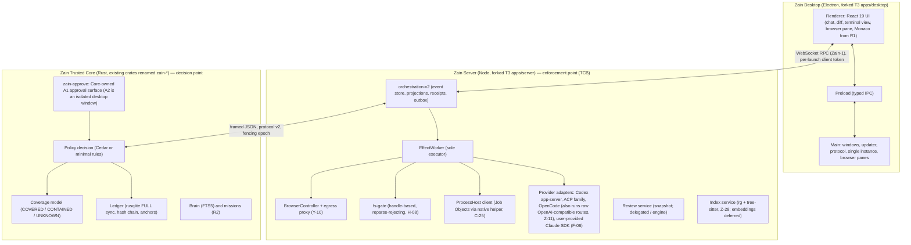

# 05 — Target Architecture and Decisions

```text
SELECTED  = V3 ADR-001 confirmed: hard fork of T3 Code (Electron + Node server + React) as shell, server and agent
            orchestration; existing Rust core becomes the Zain Trusted Core (decision point + ledger); bounded Orca ports
CHALLENGE = re-evaluated against a Code-OSS fork for the IDE pillar (§2); ADR-001 stands, with an evidence gate (Z-20)
NEW ADRs  = ADR-Z01..ADR-Z07 (§5); V3 ADR-001..ADR-024 remain authoritative (specs/008 ADR.md)
DETAIL    = V3 07_TARGET_ARCHITECTURE_AND_UX.md, 16_ZAIN_PRODUCT_COMPONENTS.md, 17_TRUST_BOUNDARY_SPEC.md,
            18_PROVIDER_ENFORCEMENT_MATRIX.md, 19_COMPONENT_SECURITY_REVISIONS.md
```

## 1. Shape of the system



**R0 note.** Until R1, the Server runs T3's own approval flow with the Supervised default (F-07). The Core is not yet
in the effect path, so R0 makes no mediation and no injection-control claim (ADR-Z01). The Core is the single ledger
writer; the approval surface reports to the policy decision point, never to the ledger directly.

## 2. Approaches evaluated

V3 compared six options (00 §3) and chose A. The IDE pillar in this mission asks whether a Code-OSS base would serve
better, so this plan adds option G and compares the two on the founder's real constraints.

| Criterion | **A. T3 fork + Rust Core (selected)** | **G. Code-OSS fork + T3 server as sidecar** |
|---|---|---|
| IDE without AI (LSP, DAP, multi-root, extensions, settings, SCM UI) | Weak at start; Monaco in R1, LSP/DAP in R3 (LSP spike in R1 if Z-20 confirms Monaco, DEC-05); external editor bridge meanwhile | Strong from day one; Open VSX extensions only (Microsoft Marketplace excludes forks) |
| Agent workbench (multi-provider sessions, worktrees, checkpoints, diff review) | Present in donor (T3 orchestration-v2) | Must be ported into VS Code's workbench or run as a second UI |
| Authority seams for the Trusted Core | Exact seams identified (R02 §10, S1–S9) | Extension host runs arbitrary extensions with full Node access; mediation seams far wider |
| Size and upkeep | ~1.0M non-test TS lines; fast-moving upstream (36d4d711 → v0.1.7 in 12 days) | VS Code is larger still and ships monthly; Code-OSS forks (Cursor, Windsurf, Positron) rebase with dedicated teams |
| Build on founder hardware (16 GB RAM, ~20 GB usable disk) | Plausible after Z-07 | Unlikely without more disk and RAM (I) |
| License | MIT | MIT + trademark limits + marketplace terms |
| Evidence | Source-read (R02, R11); build not yet run | Not measured |

**Decision.** Keep A. The decisive factors are the agent-first donor, the defined authority seams and what this
hardware can build. The IDE gap is real (RK-12). It is handled in three steps instead of a re-platform: the external
editor bridge in R0b (Z-13), then Monaco plus local completion and index in R1 (F-17, Z-12, Z-28), then LSP/DAP
(I-03/I-04, timing DEC-05). Z-20 measures A against G and a middle path (monaco-vscode-api workbench services). If G
wins on measured data, ADR-001 is reopened through a formal decision, never changed silently.

## 3. Subsystem contracts

Each subsystem has one owner and one source of truth (V3 ADR-004 "one authority per fact").

| Subsystem | Responsibilities | Interfaces / events | Data owned | Trust boundary | Failure handling | Tests | Tech (rationale) | Tasks |
|---|---|---|---|---|---|---|---|---|
| Application shell | Windows, lifecycle, single instance, protocol, updater, packaging hooks | Preload IPC; Server RPC client; update manifest | Window state, Electron userData (Zain-only, Q-02) | Renderer untrusted; main trusted | Server child restart; safe-mode launch | FWB-02..04, PKG-01 | Electron 44 from T3 (ADR-002) | Q-02, F-04, F-11 |
| Editor kernel | Editing, completion, inline edit, LSP/DAP client | Monaco APIs; LSP over stdio via Server; FIM via model gateway | Open buffers (transient) | Language servers are untrusted child processes | Server crash isolates editor; completion off on timeout | EDIT-01, DBG-01/02, GATE-PERF-07 | Monaco 0.57 (ADR-003) | F-17, Z-12, Z-20, I-03, I-04 |
| Agent runtime | Provider sessions, turns, tools, plan mode, role routing | orchestration-v2 commands/events; ACP; Codex app-server | Thread, run, turn state (`statev2.sqlite`) | Provider output is untrusted input | Receipts, outbox leases, process-loss reconciliation (T3) | FWB-01, PEM-*, V1-* | T3 orchestration-v2 on Effect 4 | Q-05, F-16, L-01, V-01 |
| Workflow engine | Missions, continuations, schedules, engineering loop | Core mission API; idempotent commands into Server | Missions, continuations (Core ledger) | Same as Core | Two-phase fire; missed-run policy; continue-as-new | ES-AT-*, W* | Core-owned (ADR-005; Vercel patterns only) | M-01..M-07, E-01..E-07 |
| Context engine | Repository index, retrieval, Brain notes, compaction capsules | Index API; `brain.query` MCP tool | Index (local), Brain (FTS5) | Ignored files never indexed; no embeddings until V3 ADR-006 is amended | Rebuild from source of truth | GATE-CTX-01 | rg + tree-sitter + FTS5 (REIMPLEMENT) | Z-28, M-03..M-05 |
| Model gateway | Capability probes, routing, server-side data classes, budgets, pre-session endpoint checks for hosted agents | Provider adapter API; probe results; routing log | Endpoint registry, budgets | Remote endpoints untrusted; private data only to authorized routes; agents' own connections stay UNMEDIATED until R1/S-04 | Explicit fallback chain; refuse with reason | GATE-MODEL-01, GATE-MODEL-02, PROV-01 | Zain-owned adapter in Server | Z-11, F-22, B-06, C-24 |
| Tool execution broker | Shell, filesystem, git, browser, desktop operations | EffectWorker → ProcessHost / fs-gate / BrowserController / DeskGate | Effect requests (outbox) | All effects pass the Server; from R1 every mediated effect asks the Core | Kill tree; quarantine; disk reserve | DG-N*, FSG-*, GATE-SEC-03 | Native helper + Node | C-25, H-08, H-01..H-05, Z-19 |
| Security system | Policy decisions, approvals, coverage, ledger, anchors, containment | Core protocol v2; approval surface | Grants, decisions, effect outcomes, ledger | Core is the only PDP (ADR-007) | Fail closed on UNKNOWN required coverage | LED-*, APR-*, COV-*, SBX-01 | Rust (existing crates) | C-00..C-28, S-01..S-06 |
| Workspace manager | Projects, worktrees, sessions, restore | Server project/worktree APIs | Project registry, worktree map | Project roots bound per thread | Crash restore (Z-21) | GATE-REC-01 | T3 | Z-21, F-16 |
| Git engine | Diffs, checkpoints, commits, branches, PRs | VcsDriver; hidden refs `refs/zain/checkpoints/*` | Checkpoint refs | Destructive ops gated from R1 (C-12 S7) | Quarantine before clean (Z-27) | GATE-J12, GATE-J18 | T3 GitVcsDriver | Z-27, C-12, E-06 |
| Review service | Snapshot, findings schema, delegated and engine modes | Findings schema; Code Review panel | Findings, fingerprints | Reviewer reads only the screened snapshot (19 §2) | REVIEW_BLOCKED when no authorized route | ZCR-T*, ZCR-Q* | OCR fork + Zain UX | K-01..K-11, Z-06 |
| Testing engine | Unit, integration, E2E, journeys, recovery suites | Playwright for Electron; recovery harness | Test reports | Synthetic credentials only | Flake count must be 0 in 3 runs | Journey gates (J01–J20), V3 R and W suites | Playwright (INTEGRATE) | Z-15, Z-16, E-03, C-20 |
| Extension platform | MCP connections, Agent Skills, MCPB | MCP; SKILL.md loader | Installed extensions, pins | Extensions untrusted; per-tool grants | Hash-pinned; re-review on update | V-05..V-07 tests | MCP/skills standards | V-05, V-06, V-07 |
| UI architecture | Design system, accessibility, approvals and diff UX | Token file; component library | Tokens | — | Error and empty states per journey | GATE-A11Y-01, A11Y-* | React 19 + Tailwind 4 (from T3) | Z-17, F-14, C-14, C-15 |
| Persistence layer | Server state, Core ledger, backups | `node:sqlite` (Server), rusqlite (Core) | `statev2.sqlite`, ledger DB | Ledger append-only, envelope hash | WAL + FULL sync; anchors | LED-*, B13 | SQLite in both processes | C-03, B-05, C-19 |
| Observability | Activity view, receipts, local traces, perf harness, reports | Local OTel sink (observational only) | Traces (local) | No external telemetry | — | GATE-PERF-BASE | Local only | Z-14, I-10, Z-23 |

## 4. Critical sequences

**R1 mediated file write by an ACP agent** (follows V3 07 §3 and 17 §1)

```mermaid
sequenceDiagram
  participant A as ACP agent
  participant S as Zain Server (PEP)
  participant C as Zain Core (PDP + ledger)
  participant U as Approval surface (A1 zain-approve / A2 window)
  participant F as fs-gate
  A->>S: fs/write(path, bytes)
  S->>S: stage bytes (staged object id, input digest)
  S->>C: propose{logical_operation_id, exact_target, input_digest, principal}
  C->>C: policy decision + coverage check
  alt needs approval
    C->>U: approval request (canonical binding, level)
    U-->>C: approve / deny / expire
  end
  C->>C: durable dispatch record (fsync; fencing epoch; staged object id)
  C-->>S: grant id (or deny)
  S->>F: write staged object via handle (no-follow, reparse rejected)
  F-->>S: APPLIED | NOT_APPLIED | UNKNOWN
  S->>C: report(outcome, evidence)
  C->>C: ledger append (hash chain)
  S-->>A: result
```

**Model routing with data class (Z-11)**

```mermaid
sequenceDiagram
  participant T as Turn
  participant G as Model gateway
  participant L as Local endpoint
  participant R as Authorized remote endpoint
  T->>G: request(task_class=agent_edit, project, needs=[tool_calls])
  G->>G: data_class = max(project class, content class); unknown fails closed
  G->>G: candidates = routes with probe(tool_calls)=pass AND data_class allowed AND budget left AND endpoint identity verified
  alt local candidate exists
    G->>L: request
  else authorized remote exists
    G->>R: request
  else none
    G-->>T: refuse(reason) — never fall back to an unauthorized route
  end
```

**Crash recovery (Z-21)**: on relaunch the Server replays its event store, reconciles leased effects
(`reconcileAfterProcessLoss`), marks the in-flight turn interrupted, and lists unknown outcomes. From R1 the Core
reconciles open dispatches per V3 17 §1 before any retry.

## 5. New architecture decisions

| ADR | Decision | Rationale | Tasks |
|---|---|---|---|
| ADR-Z01 | The first release is R0, a private daily driver that makes **no** mediation or security claim | Usable value years before full trust; honesty about enforcement | Z-15, Z-21, GATE-R0-EXIT (DEC-07) |
| ADR-Z02 | Routes that Zain launches or configures go through a capability- and server-classified data-class gateway; hosted agents are checked before a session starts (effective endpoint and provider config); no hard-coded model names; no silent fallback. Agents' own file reads and network calls are not covered and stay UNMEDIATED until C-17/S-04 | Provider neutrality; privacy; local-first; honest scope | Z-11, Z-12 |
| ADR-Z03 | IDE parity in steps: external editor bridge, then Monaco plus local completion and index, then LSP/DAP; Z-20 decides between Monaco + LSP client and monaco-vscode-api before F-17; a Code-OSS fork stays a desk estimate and reopens ADR-001 only by founder decision | Keeps the agent-first donor and authority seams; respects hardware | Z-13, Z-20, F-17, Z-28 |
| ADR-Z04 | Until the repository is private, build work, donor source and artifacts stay local; only non-sensitive planning text may be pushed, and only after DEC-02 | Privacy rule; V3 OPUS packet | Z-01, Z-02, Z-07 |
| ADR-Z05 | Consistent with V3 ADR-011: T2 work needs a qualified reviewer (the founder) plus security review; model reviews are advisory for T2 and may substitute only for T0/T1 when the model family differs from both the builder and the provider under test and the route is authorized for the data class; otherwise REVIEW_BLOCKED. V-01 checks model family, not just route | Independent review; resolves the hosted-provider review dependency | Z-06, V-01, K-08 |
| ADR-Z06 | Destructive operations are quarantine-first; bulk deletes, synced or protected paths and low disk space are enforced conditions | Disk-full incident; untracked-file loss in T3 revert; public agent drive-wipe reports | Z-19, Z-27 |
| ADR-Z07 | The master-plan layer is machine-checked: registries are the source of truth, docs are generated or cross-checked, V3 is mirrored not rewritten | Avoid duplicated plans and fail-open validation | Z-05, Z-26 |
