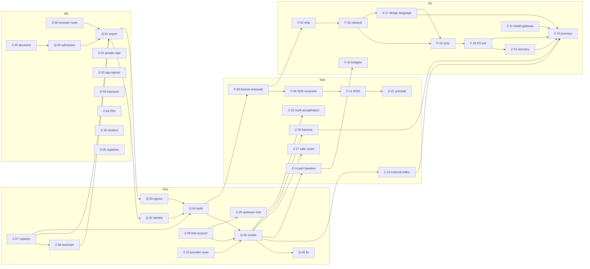

# 10 — Roadmap and Critical Path

```text
SOURCE    = registry/zain-task-backlog.csv + registry/zain-dependency-edges.csv (hard and gate edges)
GENERATED = the table and chains in §2 are produced by `python -I docs/zain-master-plan/tools/zmp.py render`;
            `zmp.py check` fails (E-GEN-DRIFT) if they disagree with the registries
ESTIMATES = person-weeks (pw) of focused implementation work, reading-based (V3 estimate class); MEASURE tasks excluded
```

## 1. Milestone ladder

| Milestone | Outcome | Entry condition | Exit gate |
|---|---|---|---|
| **M0** Privacy and repository control | Repository private; app egress closed; exposure assessed; PRs reconciled; reviewer route chosen; incident note; founder decisions | Founder accepts starting M0 | GATE-M0-EXIT (runs in parallel with R0a; it gates pushing, not local building) |
| **R0a** First Working Build | Locally built unsigned installer; isolated smoke with a real provider turn; one-day trial of upstream T3 (Z-29) | Z-25 decisions DEC-01/02/04/07/08/12; Z-06 reviewer route; Z-07 capacity; Z-08 toolchain (V3 A3–A7). Local work only | GATE-R0A-EXIT |
| **R0b** First release: founder daily driver | No telemetry; keyring credentials; supervised default; clean uninstall; open-in-editor; per-hunk accept/reject; non-destructive revert; journey harness; baseline measured | R0a PASS | GATE-R0B-EXIT |
| **R0** Zain 1.0 qualified | Strip/rebrand/admission; governance reset (G-03); model gateway; design language; WSL backend; journeys J02–J22; recovery; docs; validator repaired; 10 days of daily-use evidence | R0b exit | GATE-R0-EXIT |
| **R1** Trusted Starter | Core authority, approvals, ProcessHost, fs-gate, Monaco, local completion and index, R1 journeys | R0 exit; A3-01/A3-02/C-1 fixed (Z-26); C-00 feasibility | GATE-R1-EXIT |
| **R2–R7** | Workflows, IDE breadth, design studio, sandbox, general agents, remote | Previous exit; founder decides whether to continue each tier based on R0/R1 use | V3 exits (M-07, V-08, I-08, D-08, S-05, X-01 successors) |
| **PD** optional paid | Code signing, notarization, trademark filing | Founder decision; never a dependency | — |

## 2. Effort, cumulative totals and dependency chains (generated)

<!-- GENERATED:BEGIN zmp-roadmap (tools/zmp.py render) -->

| Milestone | New tasks (V3 / ZMP) | New effort pw (low–high) | Unmeasured | Cumulative tasks | Cumulative pw (low–high) | Longest dependency chain, pw (low–high) |
|---|---|---|---|---|---|---|
| M0 | 8 (0 / 8) | 1.75–2.15 | 0 | 8 | 1.75–2.15 | 0.50–0.50 |
| R0a | 12 (7 / 5) | 3.30–8.10 | 1 | 20 | 5.05–10.25 | 2.40–6.20 |
| R0b | 16 (10 / 6) | 5.55–9.80 | 1 | 36 | 10.60–20.05 | 4.15–8.70 |
| R0 | 36 (27 / 9) | 15.65–27.85 | 0 | 72 | 26.25–47.90 | 9.10–17.40 |
| R1 | 45 (40 / 5) | 50.15–75.65 | 0 | 117 | 76.40–123.55 | 25.45–42.50 |
| R2 | 47 (46 / 1) | 44.75–71.30 | 0 | 164 | 121.15–194.85 | 30.40–51.70 |
| R3 | 19 (19 / 0) | 36.75–65.25 | 0 | 183 | 157.90–260.10 | 31.15–51.70 |
| R4 | 8 (8 / 0) | 9.20–14.70 | 0 | 191 | 167.10–274.80 | 31.15–51.70 |
| R5 | 6 (6 / 0) | 10.30–17.80 | 0 | 197 | 177.40–292.60 | 31.15–51.70 |
| R6 | 5 (5 / 0) | 13.50–22.50 | 0 | 202 | 190.90–315.10 | 32.40–55.70 |
| R7 | 5 (5 / 0) | 4.70–9.30 | 0 | 207 | 195.60–324.40 | 32.40–55.70 |
| PD | 3 (3 / 0) | 1.00–2.00 | 0 | — | 195.60–324.40 | 0.70–1.50 |

Longest dependency chain (high estimates) to each early exit:

- **R0a:** Z-25 → Q-00 → Q-01 → Q-02 → Q-04 → Q-05 = 6.20 pw
- **R0b:** Z-25 → Q-00 → Q-01 → Q-02 → Q-04 → F-20 → F-06 → F-11 → Z-22 = 8.70 pw
- **R0:** Z-25 → Q-00 → Q-01 → Q-02 → Q-04 → F-20 → F-02 → F-03 → Z-17 → F-14 → F-16 → Z-21 → Z-15 = 17.40 pw
- **R1:** Z-25 → Q-00 → Q-01 → Q-02 → Q-04 → F-20 → F-02 → F-03 → Z-17 → F-14 → F-16 → F-13 → C-01 → C-02 → C-03 → C-04 → C-10 → C-09 → C-20 → C-22 → V-01 → K-04 → K-08 → X-01 = 42.50 pw

<!-- GENERATED:END zmp-roadmap -->

## 3. Reading the numbers

- **Assumptions.** One person-week = one week of focused work by the implementing agent with founder availability for
  founder-only steps. Estimates are V3's reading-based ESTIMATE class plus this plan's Z estimates. They exclude
  unmeasured tasks (Q-06 is MEASURE), learning time beyond what V3 already counts (F-13), upstream rebases and
  review wait time. V3's capacity model (A-1: one person-week per calendar week, with 35–60% upkeep after R0) turns
  the R7 total into 267–699 elapsed weeks. No calendar date is promised here.
- **The critical path is the build route, not features.** To R0a it runs Q-00 → Q-01 → Q-02/Q-03 → Q-04 → Q-05;
  any slip in capacity (Z-07) or toolchain (Z-08) delays everything after it. To R0 it continues through the license
  removals (F-20), strip (F-02), rebrand (F-03), accessibility pass (F-14), P2 exit (F-16), recovery (Z-21) and
  journeys (Z-15).
- **What R1 costs.** R1 adds 50–76 pw on top of R0's cumulative 26–48 pw, and R0 itself adds 16–28 pw on top of
  R0b's 11–20 pw. That is why the first release is R0b (DEC-07).
- **Founder review time is not in these numbers.** About 35 T2 tasks in R0a–R0 need the founder's review (RK-25).
  At roughly half a day each, that is several founder-weeks spread across the critical path.
- **Open-ended tasks are timeboxed.** Q-06 and F-21 are MEASURE tasks. Each gets a 2 pw timebox; when it runs out,
  the founder decides whether to continue, cut scope, or record FEASIBILITY_COMPLETE_WITH_FAILURES.
- **Scope honesty.** The full ladder (196–324 pw known work) is not feasible for a solo founder in a short horizon.
  Each tier after R1 should be started only on evidence from daily use (RK-03).

## 4. Parallelization

| Group | Tasks | Can run alongside |
|---|---|---|
| M0-founder | Z-01, Z-02, Z-06, Z-25 | M0-agent and the R0a prerequisites |
| M0-agent | Z-03, Z-04, Z-18 (Z-05 done, unreviewed) | M0-founder |
| R0a-prereq | Z-07, Z-08, Z-09, Z-10, Z-29 | M0 tasks; Z-26 validator repair; Q-00 read-only inventory |
| R0a build | Q-02 and Q-03 after Q-01 | Each other |
| R0b-product | Z-13, Z-14, Z-27, Z-30, Z-31 after Q-05 | V3 R0b tasks F-05, F-07, F-22, N-01, Y-00 |
| R0-product | Z-11, Z-17, Z-21, Z-33 | V3 governance reset G-03/G-05/G-08; Z-32 daily-use log; Z-34 docs |
| R1 | Z-20 first, then F-17, then Z-12 and Z-28; C-00 spikes | Core C-02..C-06 chain |

## 5. Dependency graph (early milestones)



The complete graph (440 edges) is in `registry/zain-dependency-edges.csv`; `zmp.py check` proves it acyclic and
milestone-ordered.
