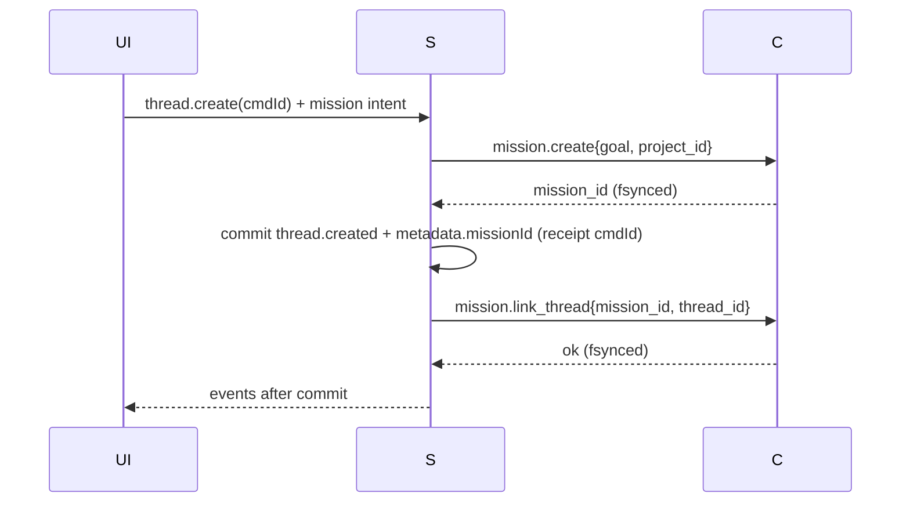
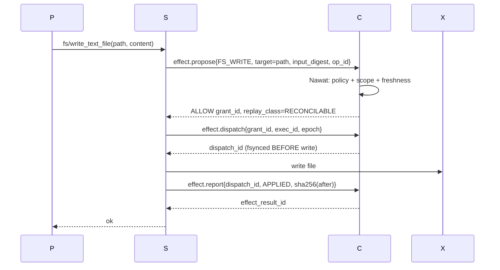
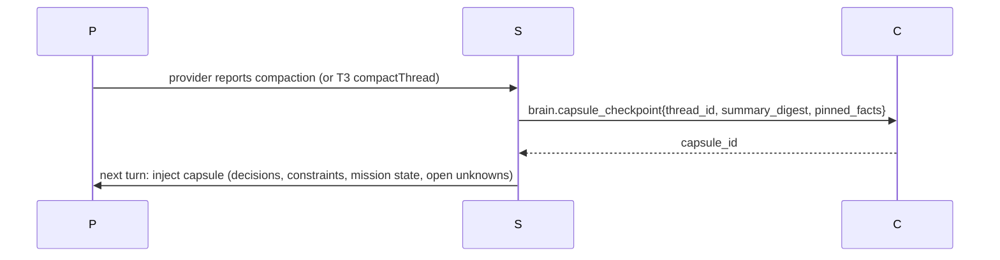
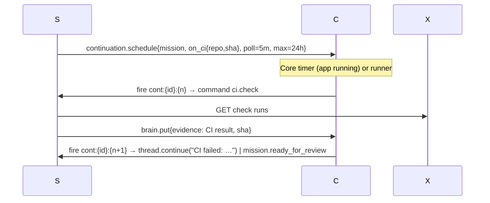
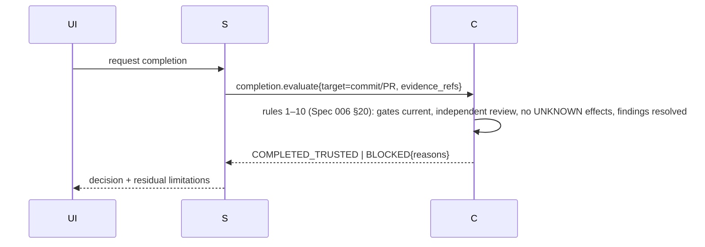

# 05 — Durability REA and the WePLD "Never Forget" Contract

```text
SOURCES = research/R05_VERCEL.md (vercel/workflow @af8c6d32, durable-harness @ea8aa406, Apache-2.0)
          research/R02_T3_CODE.md §3, §11 (T3 orchestration-v2 @36d4d711)
          specs/006-*/data-model.md §19–21 (WePLD effect model)
DECISION = Vercel Workflow SDK and durable-harness: PATTERN-ONLY. No runtime dependency. (ADR-005)
TOPOLOGY = T3 orchestration-v2 = executor + conversation truth; WePLD Core Ledger = authority + outcome + mission truth.
```

## 1. Comparison of the three candidates

| Dimension | T3 orchestration-v2 | Vercel Workflow SDK 5.2.3 | durable-harness 0.0.1 |
|---|---|---|---|
| Unit of durability | command → events + projections + receipt + outbox in one SQLite txn | step (`"use step"`), memoized `step_completed` | effect sandwich: intent → body → outcome |
| Storage | `node:sqlite`, WAL, `synchronous=NORMAL` | pluggable World; Local = JSON files, **no fsync, dev-only**; Postgres reference (no auth/encryption) | inherits World |
| Idempotency | command receipts (`commandId`), outbox `ON CONFLICT DO NOTHING` | `stepId` | `io.stepId`; retries get new stepId with `retryOf` |
| Replay classes | process-bound effects **cancelled** on restart; listed replay-safe types requeued | none (at-least-once bodies) | `safe` / `never` |
| Unknown outcome | not represented | not represented | surfaced to the model as "may or may not have taken effect" |
| Fencing | leases (30 s), per-thread FIFO | inline lease 860 s (fence specified, not sent) | epoch + in-band fence; live streams unfenced |
| History | compacted every 6 h; snapshots not deltas | full event log per run (25k cap) | per-session log |
| Scheduling | effects + restart continuations | durable sleep, hooks, continue-as-new; **no cron on self-host** | inbox hook |
| Permission revalidation on resume | no | no | no |
| Fit for local-first desktop | **already in the shell** | needs a production SQLite World + compiler; Electron UNKNOWN | requires Vercel Sandbox for Claude/Codex |

Conclusion: adopting either Vercel component would add a **second orchestrator** next to T3's. Neither provides the
two things WePLD actually lacks (unknown-outcome reconciliation, permission revalidation). Take the patterns.

## 2. "Never forget" as four testable properties

| Property | Definition (testable) | Owner in V3 | Mechanism |
|---|---|---|---|
| **P1 Execution durability** | After any crash/kill/power loss, every accepted command and every dispatched effect is either completed, resumed, or explicitly in `EFFECT_OUTCOME_UNKNOWN`; no silent loss. | T3 (commands, runs) + Core (effects) | T3 receipts/outbox/recovery service; Core dispatch-before-release, fsync |
| **P2 Semantic/project memory** | Goals, decisions, constraints, specs, mission state and evidence refs remain retrievable and are injected into new sessions regardless of model, provider, thread or context compaction. | Core Brain | append/supersede entries with provenance; FTS5; capsule injection at turn start; compaction checkpoint capture |
| **P3 Scheduling/continuation** | Missions waiting on time, CI, PR review or a human resume exactly once per wake condition, including after the machine was off (per missed-run policy). | Core continuations → T3 command | idempotent `cont:{id}:{seq}` commands; missed-run policy |
| **P4 Safe effect authority** | No effect executes without a current grant; grants are revalidated at dispatch; unknown outcomes are reconciled, never blindly retried; no exactly-once claim for non-cooperating APIs. | Core Nawat + Ledger | Spec 006 §19 + replay classes SAFE/RECONCILABLE/NEVER + fencing epoch |

## 3. Patterns adopted (with source)

| Pattern | Source | Applied as |
|---|---|---|
| Dense, monotonic, hash-chained slots; fail-closed capability negotiation | `@workflow/world` `interfaces.ts` (R05 §2.9) | Ledger `seq` + `prev_hash` invariants I1 |
| Effect sandwich (intent before body, outcome after) | durable-harness `driver.ts effect()` (R05 §3.2) | `effect.propose` → `effect.dispatch` → `effect.report` |
| Replay classes `safe`/`never` | durable-harness (R05 §3.3) | SAFE / NEVER **+ RECONCILABLE** (new) |
| Epoch fencing | durable-harness (R05 §3.5) | `fencing_epoch` on dispatch; stale executor writes refused |
| Chaos injected through the log, crash drills | durable-harness (R05 §3.6) | `09_*` R1–R11 suite |
| Continue-as-new for long missions | Workflow SDK (R05 §2.16) | Mission epochs: a mission rolls to a new thread with a Brain capsule |
| Receipts + transactional outbox + per-thread FIFO | T3 (R02 §3.5, §3.7) | kept as-is in the executor |

## 4. Sequence diagrams (required scenarios)

Participants: `UI` (renderer), `S` (WePLD Server: Orchestrator/EventSink/EffectWorker), `C` (WePLD Core), `P`
(provider/agent process), `X` (external system: git remote, GitHub, filesystem).

### 4.1 Creation (mission + first thread)


Crash between `mission.create` and thread commit: retry with same `cmdId`; Core `mission.create` is idempotent on
`(project_id, client_request_id)`; orphan mission without thread is shown as "draft" (not lost).

### 4.2 Tool call (ACP agent writes a file — strongest seam S3)



### 4.3 Approval (Codex asks to run a command)

```mermaid
sequenceDiagram
  P->>S: item/commandExecution/requestApproval
  S->>C: effect.propose{PROCESS_EXEC, argv, cwd}
  C-->>S: APPROVAL_REQUIRED (policy: exec outside allowlist)
  S-->>UI: Inbox item (receipt-linked)
  UI->>S: approve (human token)
  S->>C: approval.resolve{proposal, principal=user}
  C-->>S: ALLOW grant (expires 10 min, revalidate at dispatch)
  S->>C: effect.dispatch
  S-->>P: approved
  Note over S,C: Provider executes natively → outcome reported from provider event; replay_class=NEVER
```

### 4.4 Network partition (remote client loses the Server)

```mermaid
sequenceDiagram
  UI--xS: WS drops
  S->>S: runs continue; approvals queue in Inbox (durable in Core)
  UI->>S: reconnect (jittered backoff ≤5 min, T3 supervisor)
  S-->>UI: replay ≤128 events / snapshot + pending approvals from Core
```
No authority is granted while the approver is disconnected; pending approvals do not expire silently (they expire
explicitly with a ledger event).

### 4.5 Browser/desktop window disconnect

Renderer death has no durable consequence (view state only). Desktop main restarts renderer; Server and Core unaffected.
If Desktop main dies and the Server was its child, Server shuts down via `prepareForShutdown` (R02 §3.7); Core receives
EOF and closes the ledger cleanly. Next start → 4.6 reconciliation.

### 4.6 Worker crash mid-operation (kill -9 after dispatch, before report)

```mermaid
sequenceDiagram
  S->>C: effect.dispatch → dispatch_id
  S->>X: git push (in flight)
  Note over S: SIGKILL
  S->>S: restart: reconcileAfterProcessLoss (T3)
  S->>C: core.open_dispatches()
  C-->>S: [dispatch_id: GIT_PUSH, RECONCILABLE]
  S->>X: observe remote ref
  S->>C: effect.reconcile{observations}
  C-->>S: CONFIRMED_APPLIED | CONFIRMED_NOT_APPLIED | STILL_UNKNOWN
  Note over C: STILL_UNKNOWN → Inbox; dependents blocked; no blind retry
```

### 4.7 Resume on a new machine (optional runner / migration)

Supported path in v1 = **export/import of a project bundle**: git repo + Core ledger (verified chain) + Brain +
T3 thread archive. On import: `ledger.verify`; open dispatches become `STILL_UNKNOWN` (different host cannot observe
local effects); grants are **not** transferred (revalidate everything); provider sessions are not resumable across
machines unless the provider supports it (Claude resume needs its transcript; UNKNOWN for others). Live multi-machine
sync is deferred (`GAP-07`).

### 4.8 Context compaction


Test: pinned facts recalled 100% after compaction (R9).

### 4.9 PR/CI wait


Duplicate fires are no-ops by commandId. Webhooks are optional and deduplicated on provider event ID (R05 R2).

### 4.10 Terminal completion



## 5. Hosting options for durability (verified capabilities only)

| Option | Local/offline | Cost | Verdict |
|---|---|---|---|
| T3 SQLite + Core SQLite on the laptop | yes | $0 | **Default** |
| Same stack as headless runner on a user server/VPS | yes (self-hosted) | user's server | **Optional (BYO)** |
| Workflow + Postgres World self-hosted | yes | user's Postgres | Not chosen (second orchestrator) |
| Workflow on Vercel | no | metered | Rejected for core (lock-in, paid) |
| Turso/Redis community Worlds | UNKNOWN for v5 | — | Rejected (unverified) |

## 6. Recovery suite and metrics

Adopted wholesale from `R05 §7` (R1–R11, invariants I1–I6) and extended with WePLD-specific cases in `09_*` §2:
duplicate continuation fire, Core-down fail-closed, T3 power-loss rollback vs Core receipts (`ORPHANED_RECEIPT`),
grant expiry during approval wait, schema-too-new refusal.
