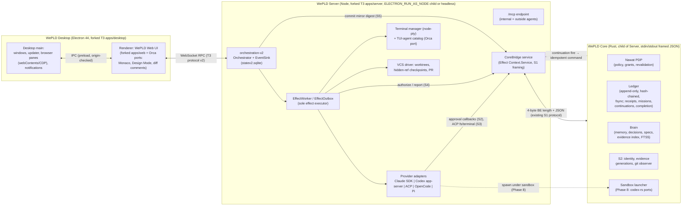

# 07 — Target Architecture and UX (WePLD V3)

```text
STATUS = PROPOSED (candidate). Grounded in R02 (T3 @36d4d711), R03D (Orca @e310a636), R05 (Vercel), Spec 006 §19–21.
PRINCIPLE = one authority per fact; one executor; one PTY host; one permission decision point; no second orchestrator.
```

## 1. Deployable components and process boundaries



| Process | Lifetime | Owns | Talks to | Crash consequence |
|---|---|---|---|---|
| Desktop main | app session | windows, update, browser panes, OS notifications | renderer (IPC), Server (spawn + WS) | Server keeps running if headless mode; UI reconnects |
| Renderer | window | view state only (rebuildable) | Server WS | none durable |
| WePLD Server | app session or service | conversation/run state, effect queue, PTYs, git ops, providers | Core (stdio), providers (child processes), WS clients | `ProviderRuntimeRecoveryService` reconciles on restart (R02 §3.7) + Core reconciliation (05 §4) |
| WePLD Core | child of Server | authority, ledger, brain, identity | Server only (no network in v1) | Server refuses all gated effects until Core is back (fail-closed); ledger survives (fsync) |
| Provider processes | per session | provider-native transcripts (co-authoritative, external) | Server | effect becomes UNKNOWN if mid-dispatch |
| Optional runner | always-on, user server | same Server+Core stack, headless | desktop/web/mobile via WS | same as Server |

Process rule: **Core is owned by the Server**, not by Electron (T3 precedent `native/resource-monitor`, R02 §10), so
headless, WSL, SSH and self-hosted runners get the same authority.

## 2. Ownership of state (one authority per fact)

| Fact | Authoritative store | Writer | Others hold | Consistency |
|---|---|---|---|---|
| Thread/run/turn/message/plan/subagent state | `statev2.sqlite` (T3) | Server EventSink | Core: `thread_id`, `run_id` refs only | strong within Server; compactable |
| Effect queue state (pending/running/…) | T3 outbox | EffectWorker | — | operational, pruned after 7 d |
| EffectProposal, NawatDecision, EffectResult, EffectReconciliation | Core Ledger | Core | Server: `wepld.receipt-linked{receipt_id}` event (compaction-exempt) | Core fsync before grant returned |
| Mission (goal, scope, status), Mission↔thread links | Core Ledger | Core | Server thread metadata cache `missionId` | Core authoritative; cache repaired on start |
| Continuation (wake time/condition, fire count) | Core Ledger | Core | — | fire → idempotent Server command (commandId = `cont:{id}:{seq}`) |
| CompletionDecision | Core Ledger | Core (Trusted Completion) | UI projection | requires evidence refs bound to target |
| Memory/decision/spec entries, evidence index | Core Brain | Core (via Server RPC from UI/agents) | provider context via capsule injection | append + supersede; never silently edited |
| Project identity, evidence generations | Core S2 store | Core | Server: `project_id` | existing S2 semantics |
| Workspace files, git refs, hidden checkpoints | git repo / worktree | Server VCS (gated) | Core: OIDs in receipts | git is external system of record |
| Provider transcripts | provider home (Claude JSONL, Codex rollout) | provider | Server refs | external; WePLD never claims them |
| Design docs / tokens | project files (`design/*.wepld-design.json`, `tokens/*.tokens.json` DTCG) | Server design service (gated write) | Brain index | git-versioned |
| Settings, secrets | OS keyring (`@napi-rs/keyring`, T3) + settings file | Server | Core gets secret **handles**, never values, in v1 | — |

No fact has two writers. Core never writes T3 tables; Server never writes Ledger rows.

## 3. Core API (over the existing S1 framed stdio protocol)

Framing unchanged: 4-byte big-endian length + UTF-8 JSON, ≤64 KiB per frame, strictly increasing command IDs, replay
rejection (S1 code + tests). New method families (protocol v2 of the WePLD Core contract, additive):

| Method | Request (abridged) | Response | Durability before reply |
|---|---|---|---|
| `effect.propose` | `{logical_operation_id, effect_class, exact_target, input_digest, origin, thread_id?, run_id?, mission_id?, precondition_snapshot}` | `{effect_proposal_id, decision: ALLOW\|DENY\|APPROVAL_REQUIRED\|TRANSFORM\|REQUALIFY\|STALE_TARGET\|INSUFFICIENT_EVIDENCE, grant_id?, conditions, replay_class}` | proposal + decision fsynced |
| `effect.dispatch` | `{grant_id, execution_identity, fencing_epoch}` | `{dispatch_id}` | dispatch record fsynced (Spec 006 "record before release") |
| `effect.report` | `{dispatch_id, outcome_class, observed_result_digest, postcondition_refs}` | `{effect_result_id}` | fsynced |
| `effect.reconcile` | `{effect_proposal_id, observations}` | `{result: CONFIRMED_APPLIED\|CONFIRMED_NOT_APPLIED\|STILL_UNKNOWN, retry_safety_state}` | fsynced |
| `approval.resolve` | `{effect_proposal_id, principal, answer}` | new decision | fsynced |
| `mission.create/update/link_thread/close` | … | mission record | fsynced |
| `continuation.schedule/cancel` | `{mission_id, wake: {at\|on_event\|on_ci{repo,sha}}, missed_run_policy}` | `{continuation_id}` | fsynced |
| `brain.put/supersede/query/capsule` | entries with provenance refs | ids / ranked results / capsule | put fsynced |
| `completion.evaluate/decide` | `{target, evidence_refs}` | rule results / decision | fsynced |
| `ledger.verify` | range | chain OK / first bad seq | read-only |
| `core.health/version/capabilities` | (existing S1) | — | — |

Replay classes (from durable-harness `'safe'|'never'`, extended per `R05 §8`): `SAFE` (idempotent/read-only),
`RECONCILABLE` (has an observable postcondition, e.g. git ref, file hash, PR state), `NEVER` (opaque external effect).

## 4. Ledger storage

- **Engine:** SQLite via `rusqlite` (bundled), WAL, `synchronous=FULL`, one writer thread. (Ponytail: SQLite already in
  the product via T3; no server DB; FTS5 for Brain search avoids a vector service.) Pending dependency admission.
- **Tables (v1):** `ledger_events(seq PK, ts, kind, subject_id, payload_json, prev_hash, hash)`; projections
  `effects`, `missions`, `continuations`, `completions`, `brain_entries` (+ `brain_fts`), `grants`. Projections are
  rebuildable from `ledger_events`.
- **Integrity:** `hash = SHA-256(prev_hash || canonical_json(payload) || seq || kind)` (sha2 already admitted for Core).
  `ledger.verify` on startup (bounded window) and on demand.
- **Retention:** never compacted; growth budget measured (09 B10); redaction via tombstone events that keep the hash
  chain (content replaced by digest), matching Spec 006 §21 "redaction/tombstone semantics".
- **Location:** `<WePLD data root>/core/ledger.sqlite` (S2 data-root rules: absolute, qualified, no relative forms).
- **Migrations:** forward-only numbered; Core refuses to open a newer schema (explicit `UNSUPPORTED_SCHEMA` — closes
  the S2 carried limitation about unsupported-schema classification).

## 5. Failure semantics

| Failure | Behavior |
|---|---|
| Core unavailable | Server marks Core `DOWN`; every gated effect is refused (`APPROVAL_REQUIRED`-style UI with "Core offline"); chat-only turns allowed only if provider runs in read-only/sandboxed mode. |
| Server crash after `effect.dispatch`, before `effect.report` | On restart Core lists open dispatches → per replay class: SAFE → re-dispatch under same `logical_operation_id`; RECONCILABLE → `effect.reconcile` with observations; NEVER → `EFFECT_OUTCOME_UNKNOWN`, user decides; dependent irreversible effects blocked. |
| Core crash after decision, before reply | Server times out → retries `effect.propose` with same `logical_operation_id` → Core returns the stored decision (idempotent by operation id + input digest). |
| T3 DB power-loss rollback (`synchronous=NORMAL`) | Core may hold receipts for runs T3 lost; startup reconciliation re-links or marks `ORPHANED_RECEIPT` (visible, not deleted). |
| Provider native auto-approve (Full access) | Prevented by S1 clamp: WePLD removes Full access unless sandbox (Phase 8) active; documented trust limitation until then. |
| Duplicate continuation fire | commandId `cont:{id}:{seq}` → T3 receipt makes it a no-op (R02 §3.5). |
| Schema too new | Fail closed with explicit message; no partial open. |

## 6. Trust boundaries

1. Renderer ↔ Desktop main: context-isolated preload, origin-checked IPC (T3 + Orca pattern).
2. Clients ↔ Server: T3 scoped sessions, DPoP-bound WS tickets (R02 §5). `terminal:operate`/`orchestration:operate`
   are root-equivalent — WePLD maps them to "owner" only.
3. Server ↔ Core: anonymous pipes, `CONNECTION_GRANTS_AUTHORITY = NO`; Core treats Server as `desktop_host` principal
   and requires a human-approval token for `APPROVAL_REQUIRED` resolutions originating from UI.
4. Server ↔ provider: providers are untrusted workers; their approval requests are inputs to Nawat, never decisions.
5. Core ↔ OS (Phase 8): sandbox launcher; until then `SANDBOX != AUTHORIZATION` and the claim is limited to mediated effects.

**Honest trust claim per phase:** before Phase 8, WePLD authoritatively controls effects that pass through T3 (ACP
fs/terminal, WePLD terminals, git ops, MCP tools, outbox effects) and provider approval prompts. It does **not**
control tools a provider executes natively without asking. The UI must display this.

## 7. Information architecture (UX)

Simplified from the 15 areas proposed in the mission brief to **5 primary destinations + 2 utilities**:

| Destination | Contains | Replaces |
|---|---|---|
| **Home** | Inbox (approvals, unknown outcomes, finished missions, mentions), quick composer, recent | Home/Inbox, Notifications |
| **Projects** | per project: Threads (chat + code sessions), Missions, Files/Editor, Design, Documents/Artifacts, Git/PRs, Brain | Chat, Code, Design Studio, Projects, Missions, Artifacts, Research, History/Memory |
| **Work** | cross-project missions, schedules/continuations, running agents, runners | Work/Cowork, Automation |
| **Review** | review queue, findings, completion decisions, evidence timeline | Review/Assurance |
| **Connections** | providers/workers, MCP servers, skills/plugins, integrations (GitHub, Linear) | Skills/Plugins, Connections |
| Settings (utility) | permissions/policy, data, appearance, keybindings | Settings |
| Command palette (utility) | everything, keyboard-first | — |

One composer everywhere: the composer decides chat vs task (Claude's unified chat/Cowork pattern, `CL-A-001`), with
explicit overrides: `/plan`, `/mission`, `/design`, `/review`, worker picker, permission ceiling chip.

Visual identity: WePLD-owned design tokens (own typeface choice, palette, iconography). No Anthropic/T3/Orca chrome,
logos or trade dress. Readable defaults: 14 px base, AA contrast, density toggle.

## 8. Local vs internet vs self-hosted

| Capability | Local-only | Needs internet | Can run on user server |
|---|---|---|---|
| UI, threads, terminal, editor, git, Brain, Ledger, policy | ✓ | — | ✓ |
| Cloud model providers | — | ✓ (user's keys/subscriptions) | ✓ |
| Local models (Ollama/LM Studio via OpenAI-compatible or ACP agents) | ✓ | — | ✓ |
| GitHub/Linear/MCP remote connectors | — | ✓ | ✓ |
| Scheduled missions while laptop is off | — | — | ✓ (opt-in runner only) |
| Mobile/web control | LAN/Tailscale direct | relay optional (no WePLD-hosted relay in v1) | ✓ |

Powered-off laptop: state is durable; continuations with `missed_run_policy` (`RUN_ONCE_ON_WAKE` default,
`SKIP`, `ASK`) fire on next start. Physical execution while off requires the opt-in runner.

## 9. Packaging

| OS | Artifact (inherited from T3) | v1 qualification |
|---|---|---|
| Windows x64 | NSIS + Azure Trusted Signing (founder must obtain own signing) | **Primary**; arm64 later |
| macOS | DMG, notarized | Secondary (needs Apple dev account — cost, `10_*`) |
| Linux | AppImage + .deb | Secondary |
| Headless runner | `wepld serve` + `wepld service install` (systemd/launchd; Windows service = gap, R02 §7) | Linux first |

Core binary packaged per-target next to `server.asar` (T3 `resources/` pattern). Update feed: WePLD's own GitHub
Releases; CI grep gate forbids `stablyai`, `onorca.dev`, `com.stably`, `ORCA_`, `t3.codes`, `T3Tools`, Clerk/PostHog
keys in shipped code (`R03D §17`).

## 10. Rebranding and identity migration checklist

App ID `ai.wepld.desktop`; Windows AppUserModelID same; protocol `wepld://`; CLI `wepld` (collides with existing S2
`wepld` binary — merge: Core binary renamed `wepld-core`, user CLI is the Server's `wepld`); data dir `%APPDATA%\WePLD`;
env prefix `WEPLD_`; hidden refs `refs/wepld/checkpoints/...` (migration: none needed — fresh product); MCP server
name `wepld`; agent hook headers `x-wepld-*`; never write into `~/.t3`, `~/.orca`. Name-collision risks and mitigations
are tabulated in `06_*` §4.
