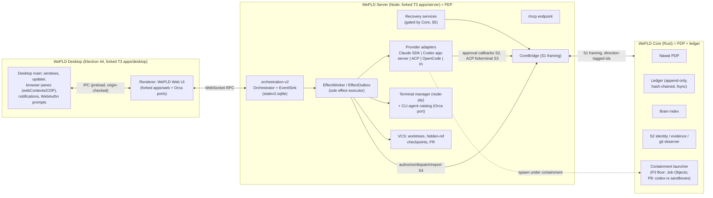

# 07 — Target Architecture and UX (WePLD V3)

```text
STATUS = PROPOSED (candidate), revision 2 after adversarial review (11_*: C1–C3, H1–H3, H7–H9, M3, M5, M8, L5).
GROUNDING = R02 (T3 @36d4d711), R03D (Orca @e310a636), R05 (Vercel), Spec 006 §19–21.
PRINCIPLES = one authority per fact; one executor; one PTY host; one policy decision point; no second orchestrator;
             the trusted computing base is named, not implied.
```

## 1. Deployable components and process boundaries



| Process | Lifetime | Owns | Crash consequence |
|---|---|---|---|
| Desktop main | app session | windows, updater, browser panes, OS notifications, WebAuthn ceremony UI | renderer/Server unaffected if headless; UI reconnects |
| Renderer | window | view state only | none durable |
| WePLD Server | app session or service | conversation/run state, effect queue, PTYs, git ops, providers | Core-gated reconciliation (§5) |
| WePLD Core | child of Server | authority, ledger, Brain index, identity | Server refuses gated effects until Core returns (fail-closed); ledger survives |
| Provider processes | per session | provider-native transcripts (external) | in-flight effects become UNKNOWN or reconciled |
| Optional runner | always-on | same Server+Core stack | same as Server |

**Trusted computing base (TCB), stated explicitly:** Core **decides** (PDP) and records; the forked Server **enforces**
(PEP) and reports what it observed. Therefore the Server — including third-party provider SDKs that run in its process
(Claude Agent SDK, OpenCode SDK) — is inside the TCB for every mediated effect. Core records what the Server reports, not
an independent observation of the world, except where Core itself observes (S2 git observer, reconciliation reads).

## 2. Ownership of state (one authority per fact)

| Fact | Authoritative store | Writer | Others hold | Consistency |
|---|---|---|---|---|
| Thread/run/turn/message state | `statev2.sqlite` (T3) | Server EventSink | Core: ids | compactable |
| Effect **queue** state | T3 outbox | EffectWorker | — | operational only; **UI never renders effect outcome from it** |
| EffectProposal / NawatDecision / Dispatch / EffectResult / EffectReconciliation | Core Ledger | Core | Server: per-run aggregate link event (§4) | fsync before grant/dispatch returns |
| Mission, Mission↔thread links | Core Ledger | Core | Server cache `missionId` | Core authoritative; cache repaired on start |
| Continuation + fire records (`fire_intent`, `fire_acked`) | Core Ledger | Core | — | two-phase (§5) |
| CompletionDecision | Core Ledger | Core | UI projection | evidence refs bound to target |
| **Specs, ADRs, canonical decisions** | **the repository** (git) | humans/agents via gated FS writes | Brain **indexes** them (path + blob hash) | repo outranks Brain (invariant) |
| Brain entries (memory notes, preferences, mission summaries, compaction capsules) | Core Ledger (Brain tables) | Core | capsules injected into providers | append + supersede; preferences start as `CANDIDATE` until user-qualified |
| Project identity, evidence generations | Core S2 store | Core | `project_id` | existing S2 semantics |
| Workspace files, git refs, checkpoints | git | Server VCS (gated) | Core: OIDs | external system of record |
| Provider transcripts | provider home | provider | refs | external |
| Design docs / tokens | repo files (`design/`, `tokens/*.tokens.json` DTCG) | Server design service (gated) | Brain index | git-versioned |
| Secrets | OS keyring | Server | Core: handles only | — |

No fact has two writers. Core never writes T3 tables; the Server never writes ledger rows; neither stores canonical
specs outside git.

## 3. Core API (S1 framing, protocol v2)

Framing unchanged (4-byte BE length + UTF-8 JSON). **Changes for v2:**

- **Direction-tagged ids:** Server→Core requests use the existing strictly increasing `cmd_id` space; Core→Server
  requests (continuation fires, revocation notices) use a separate `core_req_id` space, also strictly increasing and
  replay-checked by the Server. Both spaces reset only with a new **fencing epoch** (below).
- **Chunking:** payloads > 60 KiB use `{stream_id, seq, last}` chunk frames (applies to `brain.query`, `ledger.verify`,
  reconciliation observations); the 64 KiB per-frame cap stays.
- **Fencing epoch:** Core holds an **exclusive OS lock** on its data root (single Core per data root; a second Core
  fails to start). On each Server connection handshake Core mints `fencing_epoch = last + 1` (persisted, fsynced) and
  refuses any frame carrying a lower epoch. A restarted or duplicate Server therefore cannot act on stale state.

| Method | Purpose | Durability before reply |
|---|---|---|
| `effect.propose` | `{logical_operation_id, effect_class, exact_target, input_digest, origin, mediation: MEDIATED\|UNMEDIATED, ids…}` → decision + `grant_id?` + `replay_class` + `approval_challenge?` | proposal + decision fsynced; idempotent on `(logical_operation_id, input_digest)` |
| `effect.dispatch` | `{grant_id, execution_identity, fencing_epoch}` → `dispatch_id` (revalidates grant, scope, expiry) | fsynced **before** the Server releases the effect |
| `effect.report` | outcome + postcondition refs | fsynced |
| `effect.reconcile` | observations → `CONFIRMED_APPLIED\|CONFIRMED_NOT_APPLIED\|STILL_UNKNOWN` + `retry_safety_state` | fsynced |
| `core.open_dispatches` | list of dispatches without results | read |
| `approval.resolve` | `{effect_proposal_id, assertion}` where `assertion` is a WebAuthn assertion over the challenge (§6) | fsynced with the assertion |
| `mission.*`, `continuation.*`, `continuation.ack` | missions, schedules, two-phase fires | fsynced |
| `brain.put/supersede/qualify/query/capsule` | Brain | put fsynced |
| `completion.evaluate/decide` | Trusted Completion | fsynced |
| `ledger.verify`, `ledger.anchor` | integrity | read / fsynced |
| `core.mode` | `ENFORCE` (only mode in release builds) / `OBSERVE` (dev builds only; change requires WebAuthn assertion) | fsynced |

Replay classes: `SAFE` (idempotent/read-only), `RECONCILABLE` (observable postcondition: file hash, git ref, PR state),
`NEVER` (opaque external effect).

## 4. Ledger storage and integrity

- **Engine:** `rusqlite` (bundled SQLite), WAL, `synchronous=FULL`, one writer thread.
- **Scope:** **one ledger per Core data root**, partitioned by `project_id` (resolves the earlier per-project wording in
  10 K10). Export/import works per project partition.
- **Tables:** `ledger_events(seq, ts, kind, project_id, subject_id, payload_json, prev_hash, hash)` + rebuildable
  projections (`effects`, `missions`, `continuations`, `completions`, `brain_entries` + `brain_fts`, `grants`).
- **Chain:** `hash = SHA-256(prev_hash ‖ seq ‖ kind ‖ canonical_json(payload))`.
- **Honest integrity claim:** before P8 the chain is **tamper-evident against corruption, not against a same-user
  adversary** (an unsandboxed agent with the user's rights could rewrite the file and recompute an unkeyed chain).
  Mitigations from P3: (a) deny-floor rules for the WePLD data root in every provider profile (Claude managed settings,
  Codex sandbox config, ACP client policy) — the strongest mediated control; (b) approvals carry WebAuthn signatures that
  an agent cannot forge, so the decisions that matter most are verifiable independently of the chain; (c) `ledger.anchor`
  periodically writes the head hash to a signed git note / signed tag the founder pushes (out-of-machine anchor). P8
  containment upgrades the claim.
- **T3 cross-links:** one compaction-exempt **per-run aggregate** event `wepld.run-receipts{run_id, ledger_range,
  head_hash}` (not one per effect) to avoid reintroducing #21154-class growth. Ledger references to T3 ids are
  tombstone-aware: if T3 deletes a thread, the ledger keeps the id and marks `REFERENT_DELETED` on next reconciliation.
- **Retention:** never compacted; redaction via tombstones that preserve the chain.
- **Migrations:** forward-only; newer schema → explicit `UNSUPPORTED_SCHEMA` refusal (closes the S2 carried limitation).

## 5. Failure semantics (revised)

| Failure | Behavior |
|---|---|
| Core unavailable | gated effects refused; providers kept in read-only/Supervised mode; UI banner |
| **Server restart after crash** | T3's `reconcileAfterProcessLoss` and `ProviderRuntimeRecoveryService` are **seam S4b**: they may not requeue, retry or auto-continue (`provider-runtime.continue`) any effect until Core `core.open_dispatches` has been consulted. Rule: requeue only if Core says the dispatch is absent or its class is `SAFE`; `RECONCILABLE` → `effect.reconcile`; `NEVER` → `EFFECT_OUTCOME_UNKNOWN` to Inbox. T3 restart continuations become proposals like any other effect. |
| Crash after `effect.dispatch`, before `effect.report` | as above per replay class; dependents blocked while UNKNOWN |
| Core crash after decision, before reply | Server retries `effect.propose` with the same operation id → stored decision returned |
| **Continuation fire** | two-phase: Core fsyncs `fire_intent{cont, seq}` → sends `core_req` → Server commits command `cont:{id}:{seq}` → Server replies → Core fsyncs `fire_acked`. On restart, an un-acked fire is reconciled by asking the Server whether command `cont:{id}:{seq}` has a receipt; it is **never** blindly re-fired. Additionally T3's receipt table runs with `synchronous=FULL` (pragma change on the fork; cost measured in P1). |
| T3 power-loss rollback | Core receipts without T3 run → `ORPHANED_RECEIPT` (visible); un-acked fires reconciled as above |
| Two Servers on one data root | second Core cannot take the data-root lock → second Server cannot obtain authority |
| Desktop + runner both running | **project-home rule**: each project has exactly one home Core (local or runner). The non-home side is a client of the home Server for that project; it cannot propose effects for it locally. Moving home = explicit export/import (§8). |
| Schema too new | refuse to open |

## 6. Trust boundaries and approvals

1. Renderer ↔ Desktop main: context-isolated preload, origin-checked IPC.
2. Clients ↔ Server: T3 scoped sessions, DPoP-bound WS tickets. **Session scopes never authorize effects by themselves.**
3. Server ↔ Core: anonymous pipes; `CONNECTION_GRANTS_AUTHORITY = NO`; fencing epoch per connection.
4. Providers are untrusted workers; their requests are inputs to Nawat.

**Approvals (C1 fix).** An approval is valid only with a **WebAuthn assertion** (platform authenticator: Windows Hello /
Touch ID; or a paired phone's passkey for remote clients) over the challenge
`SHA-256(effect_proposal_id ‖ input_digest ‖ decision ‖ expiry ‖ fencing_epoch)` issued by Core. Core stores the
registered credential public keys (registered once during setup, itself requiring user presence) and verifies the
signature. Neither the Server, the renderer nor an agent can produce the assertion without the user's physical
presence. Desktop main merely hosts the browser WebAuthn ceremony; it holds no secret. Remote approval (phone/web,
P10) uses the same mechanism with a paired passkey. **Until this lands in P3, the Server is trusted for approvals and the
UI says so.** Policy changes, `core.mode` changes and permission-mode escalations use the same assertion.

**Mediation classes (C2 fix).** Every effect is tagged:
- `MEDIATED` — passes through a Server PEP (ACP fs/terminal, WePLD terminals' commands issued by WePLD, git ops,
  MCP tools, outbox effects, provider approval prompts with a Core decision).
- `UNMEDIATED` — happens inside a provider's own tool runtime without a prompt, or inside a CLI agent running in a PTY.
  Core records it only if reported (e.g. PostToolUse, file-hash diffs).

Trusted Completion refuses `COMPLETED_TRUSTED` when an acceptance-critical change came from `UNMEDIATED` effects; it may
return `COMPLETED_WITH_UNMEDIATED_LIMITATION`, which is shown as such. Marketing and benchmarks claim authority only over
`MEDIATED` effects until P8.

**Containment floor in P3 (C2 fix, partial).** Before the full P8 sandbox: (a) provider launch profiles deny writes to
the WePLD data root and outside the worktree (Codex `workspaceWrite`, Claude managed deny rules, ACP client policy);
(b) Windows Job Objects for process-tree ownership and kill (Orca process-host + codex `process-hardening` ideas);
(c) Full access mode removed. This is **not** a security sandbox; it narrows the unmediated surface.

## 7. Information architecture (UX)

5 primary destinations + 2 utilities:

| Destination | Contains |
|---|---|
| **Home** | Inbox (approvals, unknown outcomes, finished missions), quick composer, recent |
| **Projects** | Threads (chat + code), Missions, Files/Editor, Design, Documents, Git/PRs, Brain |
| **Work** | cross-project missions, schedules, running agents, runners |
| **Review** | review queue, findings, completion decisions, evidence timeline |
| **Connections** | workers/providers, MCP, skills/plugins, integrations |
| Settings / Command palette | utilities |

One composer everywhere (chat escalates to task), overrides `/plan`, `/mission`, `/design`, `/review`, worker picker,
permission chip. A persistent **trust indicator** shows the current mediation claim (e.g. "Mediated effects only — no
sandbox yet"). Visual identity is WePLD-owned; no Anthropic/T3/Orca chrome or trade dress.

## 8. Local vs internet vs self-hosted

| Capability | Local-only | Needs internet | User server |
|---|---|---|---|
| UI, threads, terminal, editor, git, Brain, ledger, policy | ✓ | — | ✓ |
| Cloud model providers | — | ✓ (user keys) | ✓ |
| Local models | ✓ | — | ✓ |
| GitHub/Linear/remote MCP | — | ✓ | ✓ |
| Missions running while the laptop is off | — | — | ✓ **only for projects whose home is the runner** (§5 project-home rule) |
| Phone/web control | LAN/Tailscale | — | ✓ |

Powered-off laptop: state is durable; continuations with `missed_run_policy` (`RUN_ONCE_ON_WAKE` default, `SKIP`, `ASK`)
fire on next start. Moving a project's home to a runner is an explicit export/import: grants are not transferred and
open dispatches become `STILL_UNKNOWN` on the new home.

## 9. Packaging

| OS | Artifact | v1 |
|---|---|---|
| Windows x64 | NSIS; signing provider eligibility for an individual in Saudi Arabia **UNKNOWN** (Azure Trusted Signing historically restricted by entity/region) — verify; fallback OV certificate | Primary |
| macOS | DMG, notarized (Apple Developer Program) | Secondary |
| Linux | AppImage + .deb | Secondary |
| Runner | `wepld serve` + service install (Linux first; Windows service = gap) | P10 |

Core binary (`wepld-core`) packaged next to `server.asar`. Installer contents gate: fails if donor identifiers,
telemetry keys or `claude-agent-sdk*` (until G4) are present.

## 10. Identity

App ID `ai.wepld.desktop`; protocol `wepld://`; Server CLI `wepld`; Core binary renamed `wepld-core` **at P2** (the S2
`wepld` CLI's commands move under `wepld-core doctor|open|status` in the same change, so two `wepld` binaries never
coexist); data dir `%APPDATA%\WePLD`; env `WEPLD_*`; refs `refs/wepld/checkpoints/…`; MCP server `wepld`; hook headers
`x-wepld-*`. Full register in `06_*` §4.
